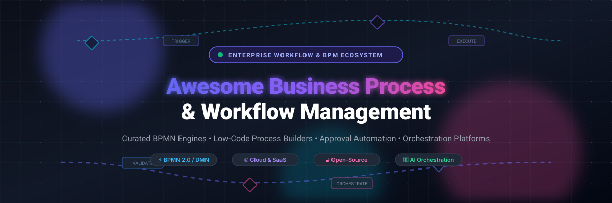
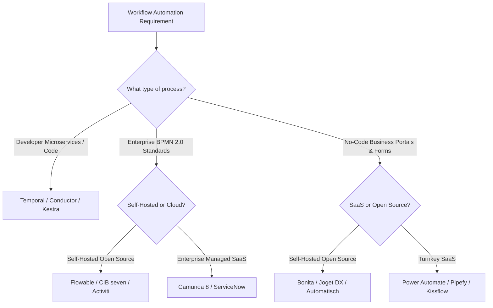

# Awesome Business Process & Workflow Management 🚀

  

# ⚙️ Awesome Business Process & Workflow Management

**Curated index of enterprise SaaS workflow suites, BPMN 2.0 orchestration engines, low-code process builders, and self-hosted approval platforms.**

*Model, automate, orchestrate, and audit end-to-end human and system business processes.*

🌟 **Star this repository if you find it helpful!** 🌟

---

## 📑 Table of Contents

- [🌐 Sector Overview & Market Dynamics](#-sector-overview--market-dynamics)
- [💼 Enterprise SaaS Platforms](#-enterprise-saas-platforms)
- [🔓 Open-Source Process Engines & Frameworks](#-open-source-process-engines--frameworks)
- [⚖️ Architecture & Selection Matrix](#️-architecture--selection-matrix)
- [🤝 How to Contribute](#-how-to-contribute)
- [💖 Support & Sponsorship](#-support--sponsorship)
- [⭐ Star History](#-star-history)
- [📜 Disclaimer](#-disclaimer)

---

## 🌐 Sector Overview & Market Dynamics

The global **Business Process Management (BPM) and Intelligent Workflow Automation** market is estimated at **$16.0B – $21.2B in 2025** and projected to exceed **$26.6B by 2026**, expanding at a robust compound annual growth rate (CAGR) of **12% to 17%** driven by enterprise digital transformation, cloud migrations, and agentic AI integration.

The sector is **moderately concentrated at the top with a fragmented long tail**: mega-cap tech giants and specialized stalwarts (such as Microsoft, ServiceNow, and Atlassian) capture high-value enterprise IT, ERP, and ITSM automation contracts, while an active, fragmented ecosystem of agile low-code vendors, niche vertical platforms, and open-source orchestrators rapidly innovate across mid-market processes, developer microservices, and AI-first workflows.

---

## 💼 Enterprise SaaS Platforms

Below is a breakdown of category-leading Business Process & Workflow Management SaaS products, sorted descending by company scale (market capitalization / valuation):

| Platform | Company Scale (Valuation / Revenue) | Starting Pricing (Specific Tier) | Free Tier / Trial Limits | Core Specialty & Best For |
| :--- | :--- | :--- | :--- | :--- |
| **[Microsoft Power Automate](https://powerautomate.microsoft.com/)** | **~$3.85T Market Cap** (~$281B Rev) | **$15/user/month** (Power Automate Premium); **$150/bot/month** (Hosted Process plan) | **Included with Microsoft 365 / Windows** (Standard connectors only; capped at 6,000 actions/day; no premium HTTP/DB connectors) | Seamless workflow automation across Microsoft 365, Teams, Azure, and 1,000+ business connectors. |
| **[ServiceNow Workflow](https://www.servicenow.com/)** | **~$160B Market Cap** (~$13.3B Rev) | **~$70 – $100/user/month** (estimated starting fulfiller tier for ITSM / Flow Designer bundles; annual contract) | **No Free Tier & No Self-Serve Free Trial** (Guided demo/proof-of-concept sandbox available via enterprise sales only) | Mission-critical enterprise process automation, ITSM lifecycle workflows, and cross-department digital services. |
| **[Jira Workflow](https://www.atlassian.com/software/jira)** | **~$45B Market Cap** (~$5.2B Rev) | **$7.75/user/month** (Standard plan for 11+ users; volume discounts scale with user count) | **Free Forever Tier**: Max 10 users, 2 GB total file storage, 100 automation rule runs/month, 100 notification emails/day | Issue tracking, software development lifecycle pipelines, and multi-step team approval workflows. |
| **[Nintex](https://www.nintex.com/)** | **~$2.0B Valuation** (~$240M Rev) | **~$1,250 – $2,080/month** (billed annually, standard entry contracts typically start around $15,000–$25,000/year) | **30-Day Free Trial** (Full workflow, forms, and DocGen access with up to 30 active workflows; no credit card required) | Heavyweight digital process automation (DPA), document generation, and deep SharePoint/Office 365 migrations. |
| **[Camunda (SaaS)](https://camunda.com/)** | **~$1.0B+ Valuation** (~$200M ARR) | **$49/month** (Starter tier for cloud process orchestration and human task management) | **30-Day Free Cloud Trial** (Full Zeebe process execution); transitions to permanent **Free Modeler tier** (unlimited BPMN/DMN modeling, 5 seats, 0 cloud task executions) | Developer-centric end-to-end process orchestration across distributed microservices, APIs, and human workers. |
| **[Kissflow](https://kissflow.com/)** | **~$150M Valuation** (~$40M ARR) | **$1,500/month** (Basic tier, includes core workflows, forms, and portal for up to 30 internal users) | **No Free Tier** (14-day guided proof-of-concept trial available upon sales qualification; requires business domain email) | Visual no-code/low-code workflow creation and procurement/HR approval routing for non-technical business teams. |
| **[Pipefy](https://www.pipefy.com/)** | **~$140M Valuation** (~$30M ARR) | **$20/user/month** (Business tier billed annually; minimum seat commitments apply) | **Free Forever Starter Plan**: Max 10 users, 5 active pipes (processes), 500 database records, 2 GB storage, 15 automation runs/month | Kanban-style visual process management, request tracking portals, and operational workflows for HR and finance. |
| **[BP Logix](https://www.bplogix.com/)** | **~$30M – $50M Valuation** (~$12M Rev) | **~$1,200/month** (or ~$50/user/month baseline subscription for Process Director cloud tier) | **No Free Tier** (Custom guided POC / trial sandbox provided through enterprise sales consultation) | Compliance-focused BPM, patented process timeline management, and audit-heavy workflows in regulated sectors. |
| **[Process Street](https://www.process.st/)** | **~$25M – $40M Valuation** (~$10M ARR) | **$100/month** (Startup flat tier; Pro tier starts at $25/user/month with annual billing) | **14-Day Free Trial** (Full access to Pro features, workflows, and forms; max 5 MB upload per file; no credit card required) | Checklist-driven recurring process management, onboarding procedures, and standard operating procedure (SOP) tracking. |
| **[Fluix](https://fluix.io/)** | **~$15M – $25M Valuation** (~$8M Rev) | **$29/user/month** (Crews tier, minimum 10 users = $290/month minimum commitment) | **14-Day Free Trial** (Full mobile and web operations access, form builder, and digital signatures; no credit card required) | Mobile-first workflow automation, field inspection forms, and document approval routing for distributed frontline teams. |

---

## 🔓 Open-Source Process Engines & Frameworks

A curated directory of production-grade, open-source workflow and BPM projects, sorted descending by GitHub stargazers:

| Project | GitHub_Stars | Primary Stack | License | Description & Architectural Highlights |
| :--- | :--- | :--- | :--- | :--- |
| **[Temporal](https://github.com/temporalio/temporal)** |  | Go / Polyglot SDKs | MIT | **Resilient microservice execution platform.** Code-as-workflows paradigm that guarantees state durability, automatic retries, and distributed transaction orchestration. |
| **[Kestra](https://github.com/kestra-io/kestra)** |  | Java / Vue.js | Apache-2.0 | **Event-driven declarative orchestrator.** YAML-defined workflows with rich built-in web UI, plugin ecosystem, and real-time execution monitoring for business and data pipelines. |
| **[Netflix Conductor (OSS)](https://github.com/conductor-oss/conductor)** |  | Java | Apache-2.0 | **Distributed microservice orchestration engine.** Scalable workflow definitions in JSON/code with high throughput, task queues, and visual state tracking. |
| **[Automatisch](https://github.com/automatisch/automatisch)** |  | Node.js / React | AGPL-3.0 | **Self-hosted Zapier alternative.** Open-source business automation platform for connecting enterprise cloud applications without storing sensitive data with third parties. |
| **[Activiti](https://github.com/Activiti/Activiti)** |  | Java (Spring Boot) | Apache-2.0 | **Battle-tested BPMN 2.0 execution engine.** Lightweight, embeddable business process suite running in any Java runtime or Kubernetes cluster. |
| **[Flowable](https://github.com/flowable/flowable-engine)** |  | Java (Spring Boot) | Apache-2.0 | **Modern BPMN, CMMN, and DMN engine suite.** First-class Spring Boot starter, modular REST APIs, and high-performance event-driven process execution. |
| **[Elsa Workflows](https://github.com/elsa-workflows/elsa)** |  | .NET (C#) / TypeScript | MIT | **Native .NET workflow management engine.** Visual designer and code-centric orchestration library for .NET applications, async background tasks, and event routing. |
| **[Workflow Core](https://github.com/danielgerlag/workflow-core)** |  | .NET (C#) | MIT | **Lightweight embeddable workflow engine for .NET.** Fluent API, persistent state storage, compensation steps, and concurrency-safe distributed steps. |
| **[jBPM (Apache KIE)](https://github.com/kiegroup/jbpm)** |  | Java | Apache-2.0 | **Comprehensive business automation suite.** Integrates BPMN 2.0 process flow with Drools business rules, decision tables (DMN), and complex event processing. |
| **[Bonita Engine](https://github.com/bonitasoft/bonita-engine)** |  | Java | GPL-2.0 | **Low-code BPM platform.** Provides an all-in-one studio, visual form designer, BPMN execution engine, and customizable user portal for business apps. |
| **[Joget DX Community](https://github.com/jogetworkflow/jw-community)** |  | Java | GPL-3.0 | **Next-gen open-source low-code application platform.** Merges visual process workflows, form builders, and AI-assisted agentic orchestration. |
| **[ProcessMaker Community](https://github.com/processmaker/processmaker)** |  | PHP (Laravel) / Vue.js | AGPL-3.0 | **Open-source web-based BPM and workflow platform.** Drag-and-drop process modeling, electronic forms, document approval routings, and case management. |
| **[Imixs-Workflow](https://github.com/imixs/imixs-workflow)** |  | Java (Jakarta EE) | EPL-2.0 | **Pure 100% open-source BPM engine.** No enterprise tiers, no paywalled limits; strictly adheres to BPMN 2.0 human-centric workflow standards. |
| **[CIB seven](https://github.com/cibseven/cibseven)** |  | Java / Vue.js | Apache-2.0 | **Guaranteed long-term Camunda 7 community fork.** Drop-in BPMN 2.0 and DMN 1.3 engine replacement with modern Cockpit, Admin, and Tasklist web interfaces. |

---

### 🧩 Specialized Workflow Libraries & Modules

- **[django-workflow-kit](https://pypi.org/project/django-workflow-kit/)** *(Python / Django)* — Declarative workflow, state machine, and multi-tier approval framework for Django. Features immutable versioned definitions, concurrency safety, and audit logs.
- **[Slickflow](https://github.com/bpm-platform/slickflow)** *(.NET)* — BPMN 2.0 based approval workflow engine supporting countersigning, or-sign, branch jumps, and refund approval trees.
- **[Serverless Workflow Spec](https://github.com/serverlessworkflow/specification)** *(CNCF)* — Vendor-neutral, open-standard specification for event-driven workflow orchestrations across multi-cloud and serverless ecosystems.

---

## ⚖️ Architecture & Selection Matrix

When selecting a business process and workflow platform, evaluate your organization's technical depth, compliance boundaries, and user persona:

- **Standards-First BPMN Engines (`Flowable`, `CIB seven`, `Camunda`):** Best when business analysts model processes in standard BPMN 2.0 XML while engineering teams implement service tasks, message events, and database persistence.
- **Resilient Code-As-Workflows (`Temporal`, `Conductor`):** Best for distributed systems, microservices, and backend engineers who prefer writing standard code (Go, Java, Python, TypeScript) rather than managing complex XML diagrams.
- **Low-Code Business Applications (`Bonita`, `Joget`, `Kissflow`, `Pipefy`):** Best for departmental operations (HR onboarding, finance approvals, purchase orders) where non-technical stakeholders require instant web forms, notification emails, and audit logs.

---

## 🤝 How to Contribute

Contributions are warmly welcomed! Please follow these steps:

1. **Fork** this repository.
2. Create a focused branch (`git checkout -b feature/add-new-workflow-engine`).
3. Add the project or SaaS tool with factual, verified details (pricing, limits, stack, and direct links).
4. Commit your changes (`git commit -m 'Add ProjectName to workflow list'`).
5. Push to the branch (`git push origin feature/add-new-workflow-engine`).
6. Submit a **Pull Request** detailing why the tool qualifies.

---

## 💖 Support & Sponsorship

If this curated repository saved you hours of research or helped optimize your company's workflow stack:

- ⭐ **Star this repository** to help others discover it!
- 🍴 **Fork it** and contribute your favorite open-source process engines.
- 📢 **Share it** on LinkedIn, X/Twitter, or your team's internal Slack.
- ☕ **Support the maintainer**: Buy me a coffee on the [**GitHub Sponsors Dashboard**](https://github.com/sponsors/ishandutta2007).

---

## ⭐ Star History

---

## 📜 Disclaimer

- This repository is a community-curated, independent index. All product names, logos, and brands are property of their respective owners.
- Business process automation tools handling sensitive corporate data and approval authorizations must comply with relevant data governance regulations (GDPR, HIPAA, SOC 2). Validate security configurations before deploying to production.
- Pricing, seat counts, and free tier limitations reflect publicly disclosed data as of 2026 and may change over time. Verify directly with vendors for active production requirements.
